# 🎵 Klankstroom — muziekspeler voor pc en Android

Eén app voor **radio**, **legale gratis muziek**, **je eigen (betaalde) accounts** en **muziek op je apparaat** — met een 3D-visualizer en screensaver die op de muziek reageren. Gemaakt door **Endless**.


**⬇ Downloads:** [Releases → latest](https://github.com/Endless1977/MusicPlayer/releases/latest)
· [Klankstroom.apk (Android)](https://github.com/Endless1977/MusicPlayer/releases/latest/download/Klankstroom.apk)
· [Klankstroom-Setup.exe (Windows)](https://github.com/Endless1977/MusicPlayer/releases/latest/download/Klankstroom-Setup.exe)
· [webversie](https://endless1977.github.io/MusicPlayer/)

✅ **Goedgekeurde versie:** 1.0.14 (branch [`stabiel`](https://github.com/Endless1977/MusicPlayer/tree/stabiel)): alles werkt zoals gevraagd.

## Screenshots

**Autoradio (9 inch, 1024×600):** tegels links, visualizer en speler in het midden, voorkeuzeknoppen rechts

| Radio (FM-tuner van de auto) | CD |
|---|---|
| 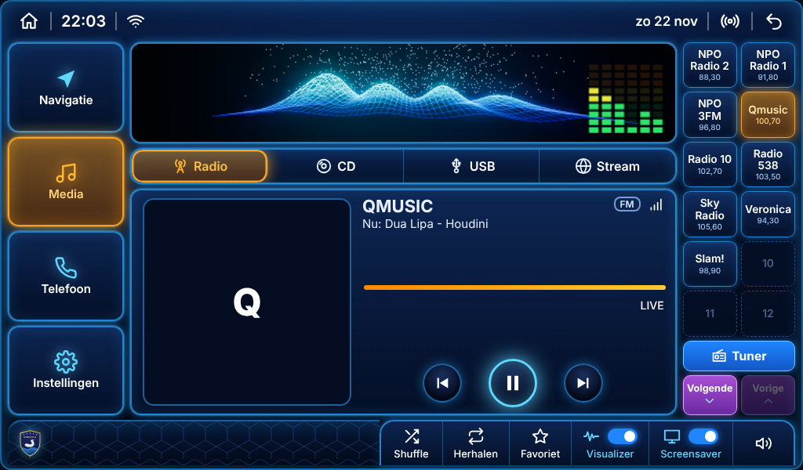 | 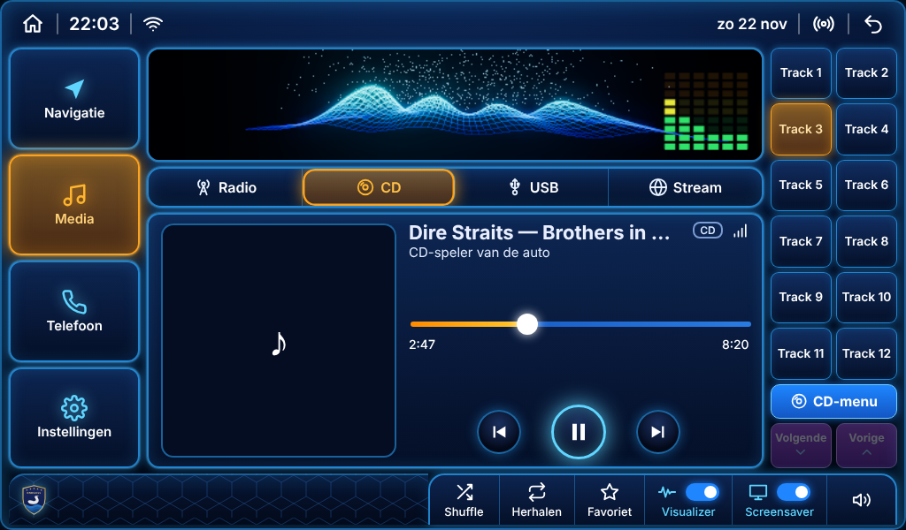 |
| **USB / SD-kaart: mappen als knoppen** | **Stream: zelf geprogrammeerde knoppen** |
| 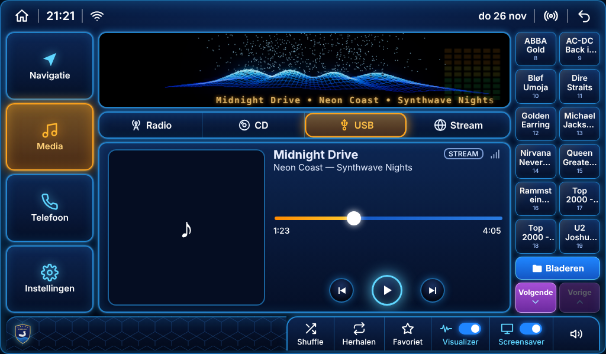 | 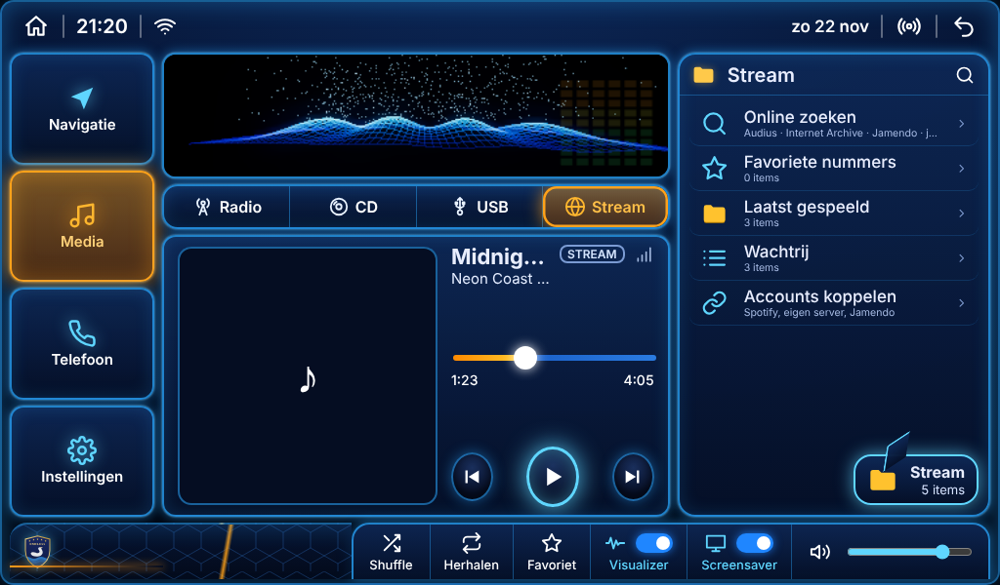 |
| **Groot zoekscherm** | **Telefoon via Bluetooth** |
| 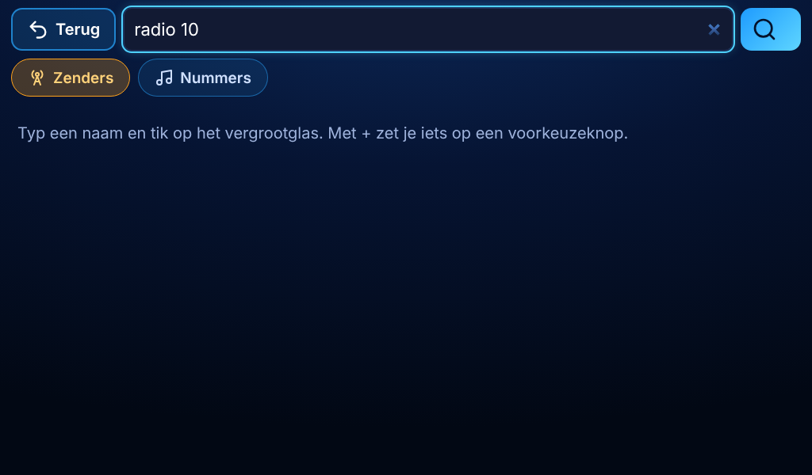 | 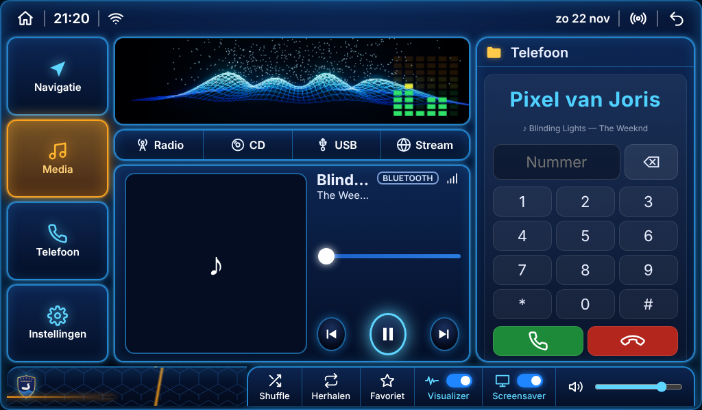 |
| **Instellingen** | **Visualizer volledig scherm (één tik)** |
| 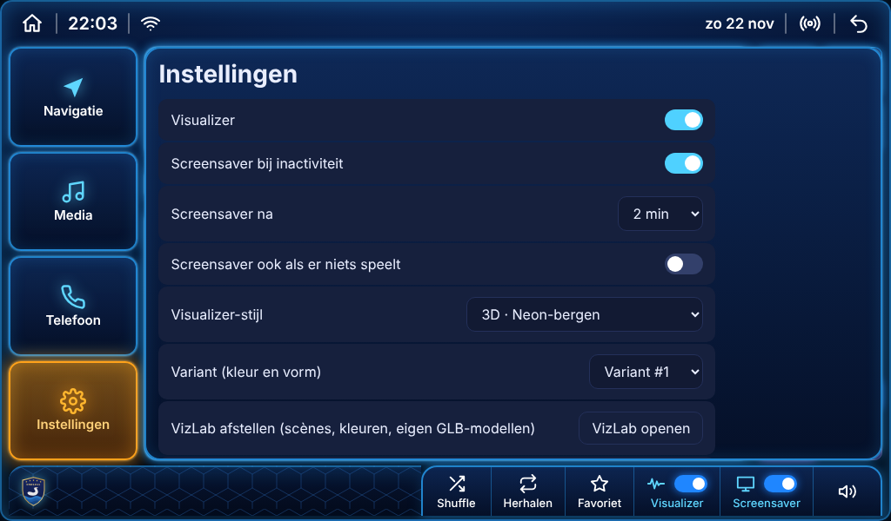 | 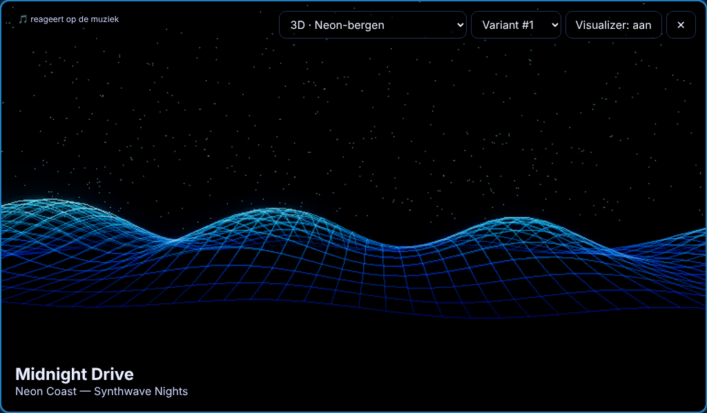 |

| Telefoon | Pc |
|---|---|
| 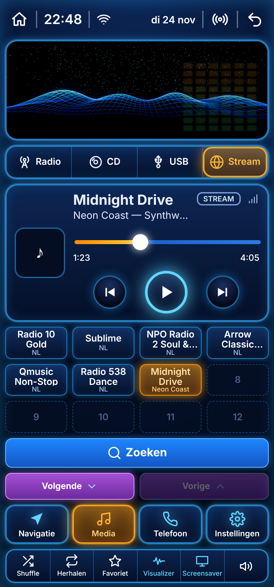 | 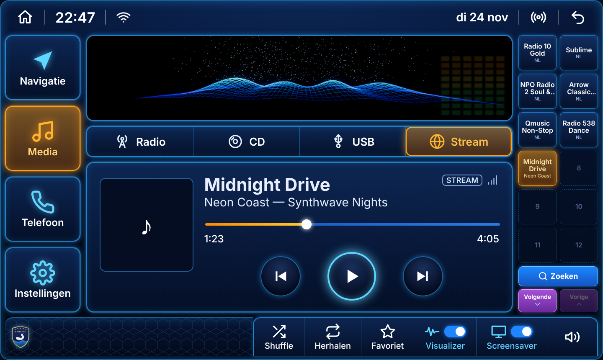 |

**Visualizers (VizLab):** een greep uit de 11 scènes

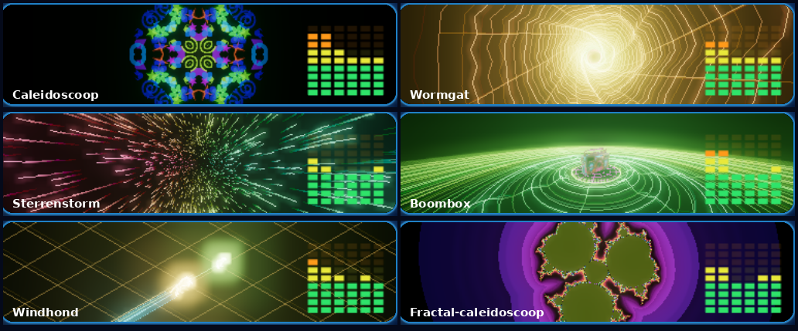

**VizLab afstellen** (Instellingen → VizLab openen) met het geluid van de speler

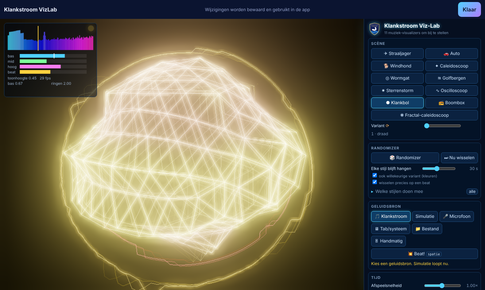

## Wat zit erin

| Onderdeel | Wat het doet |
|---|---|
| 📻 **Radio** | ±50.000 zenders uit de open [Radio Browser](https://www.radio-browser.info)-database. Zoeken op naam, land en genre. Eigen stream-URL’s (mp3/aac/m3u/pls/HLS) kun je plakken. Kapotte zenders worden standaard verborgen. |
| 🔎 **Zoeken** | Zoekt tegelijk in legale bronnen: **Audius** (gratis), **Internet Archive** (publiek domein / CC / live-opnames), **Jamendo** (CC, gratis client-ID) en je gekoppelde accounts. |
| 🔗 **Accounts** | **Spotify** (Premium, PKCE-login; op de pc speelt het in de app, op Android via Spotify Connect), **Navidrome/Subsonic** (je eigen muziekserver, bijv. op de Pi), **Jamendo**, **Audius**. Deezer/Apple Music/YouTube Music/Tidal hebben geen open afspeel-API; die openen in hun eigen app. |
| 💽 **Bibliotheek** | Lokale muziek met ID3-titels en -hoezen. Werkt **volledig offline**. |
| 📡 **Scanknop** | **Android:** interne opslag, **SD-kaart**, USB-sticks, **USB-CD-speler**, de ingebouwde **FM-radio**-app van je telefoon en audio-ingangen. **Pc:** alle schijven, USB/SD, **CD-station** en de map Muziek. |
| 🌀 **Visualizer** | De 11 scènes van het **Klankstroom VizLab** (Straaljager, Auto, Windhond, Caleidoscoop, Wormgat, Golfbergen, Sterrenstorm, Oscilloscoop, Klankbol, Boombox, Fractal-caleidoscoop), **Neon-bergen** en de 3D-scènes in vizz.fm-stijl, elk met **16 varianten**, plus klassieke effecten in Drempels-stijl. Eén tik = volledig scherm; met 🌀 zet je hem **aan/uit**. Afstellen via Instellingen → VizLab openen. |
| 🚗 **Autoradio-indeling** | Grote tegels (Navigatie, Media, Telefoon, Instellingen), tabbladen Radio/CD/USB/Stream en rechts **voorkeuzeknoppen** zoals op een echte autoradio: FM-zenders, CD-tracks, de **mappen van je SD-kaart** en zelf te programmeren streams (3 pagina's van 12, lang drukken = opslaan/wissen). Zoeken gebeurt in een groot, duidelijk zoekscherm. Lijsten, instellingen en telefoon schuiven over het midden. Staande variant voor de telefoon. |
| 📻 **Autoradio-hardware (Microntek/HCT MTCD/MTCE, bv. PX5)** | Klankstroom stuurt de radio rechtstreeks aan, zonder de apps van de fabrikant: **FM-tuner** (afstemmen, zoeken, scannen, RDS-naam en -tekst), **CD/DVD** (afspelen, tracks, spoelen, uitwerpen), **Bluetooth-telefoon** (bellen, opnemen, ophangen, kiespad, belgeschiedenis, muziek van je telefoon) en de **navigatie-onderdrukking** (radio zachter als de navigatie spreekt). De knoppen op de radio en het stuur werken mee en zijn zelf te koppelen. Zie [docs/mtce-api.md](docs/mtce-api.md). |
| ⏻ **Automatisch starten** | Start mee als de radio opstart of het contact aangaat, en speelt verder waar je was (zender, stream of map). Kiest je Radio, dan speelt de laatste zender meteen. Beide uit te zetten. |
| 🖥 **Screensaver** | Na een instelbare tijd zonder bediening verschijnt de visualizer schermvullend, met titel en klok. Zet je hem aan of uit met de knop 🖥 of in Instellingen. |

### Sneltoetsen (pc)
`spatie` afspelen/pauze · `N`/`P` volgende/vorige · `V` visualizer aan/uit · `M` volgende stijl · `[` `]` variant · `F` volledig scherm · `S` screensaver nu

## Downloaden

Bij elke push naar `main` bouwt **GitHub Actions** alles automatisch en zet het op [Releases → latest](https://github.com/Endless1977/MusicPlayer/releases/latest):

| Platform | Bestand |
|---|---|
| Android | `Klankstroom.apk`: downloaden en installeren (sta “onbekende bronnen” toe). Een nieuwe versie installeert over de oude heen; je bibliotheek en instellingen blijven bewaard. |
| Windows | `Klankstroom-Setup.exe` (installer) of `Klankstroom-portable.exe` |
| Web | https://endless1977.github.io/MusicPlayer/ |

De APK is ondertekend met de sleutel in `signing/`. Die sleutel staat openbaar in de repo: prima voor eigen gebruik, maar niet geschikt voor de Play Store.

## Zelf bouwen

```bash
npm install
npm start                 # pc-app (Electron)
npm run dist:win          # Windows-installer in dist/
npm run android:add       # Android-project maken + eigen plugin erin
npx cap open android      # openen in Android Studio
```

De webversie draait met elke statische server: `npx http-server www`.

## Goed om te weten

- **Systeemverkenner (Android, Instellingen):** alleen lezen. Zet systeeminfo (getprop, build.prop, /proc), een inventaris van alle apps met activities/services/receivers/providers/rechten, de systeemdiensten, de methodes van Microntek-klassen (`android.microntek.CarManager` e.d.), `/system/framework` en de app-mappen van de fabrikant op de SD-kaart in `Android/data/nl.endless.klankstroom/files/verkenner-DATUM/`. Ruimte: ±0,5–1 GB (met alle apps ±1,5–3 GB).

- **Zwakke autoradio's (bv. PX5/RK3368 met PowerVR):** de app herkent de grafische chip en zet de **lichte modus** aan: geen gloedschaduwen, visualizer op halve resolutie zonder bloom, max. 30 beelden/s. Instelbaar onder Instellingen → Prestaties. In de autoradio-stijl wordt de Android-systeembalk verborgen voor meer ruimte (uit te zetten).

- **Visualizer bij radio:** veel radiostreams sturen geen CORS-headers. In de browser kan de app het geluid van zulke streams dan niet analyseren, en volgt de visualizer een gesimuleerd ritme. In de pc-app en de Android-app reageert hij op het echte geluid; blijft de analyse in Android stil, dan luistert de app mee via Android zelf (vraagt één keer microfoontoestemming, er wordt niets opgenomen). FM, CD en Bluetooth op de autoradio lopen buiten Android om; daar volgt de visualizer een geschat ritme.
- **Audio-CD’s:** Windows en Android geven CD-audio (CDDA) niet als bestand vrij. Data-CD’s met MP3’s werken wel. Een losse CD-speler of radio kun je via een **lijn-ingang** laten meespelen (scanknop → Audio-ingangen).
- **FM-radio:** op Microntek/HCT-autoradio's bedient de app de tuner zelf. Op andere apparaten heeft Android geen standaard-API voor de FM-chip; dan zoekt de app de FM-app van de fabrikant (Samsung, Xiaomi, Motorola, Qualcomm/OnePlus, enz.) en opent die.
- **Spotify:** maak een gratis app op developer.spotify.com en vul de Client-ID en Redirect-URI in die op de Accounts-pagina staan (pc: `http://127.0.0.1:43117/index.html`, Android: `nl.endless.klankstroom://spotify`).
- Je inloggegevens blijven alleen op je eigen apparaat.

## Structuur

```
www/                 de app (HTML/CSS/JS), gedeeld door web, pc en Android
  js/visualizer.js   audio-analyse + klassieke WebGL-feedbackeffecten
  js/viz3d.js        3D-scènes (three.js + bloom)
  js/player.js       speler, wachtrij, CORS-terugval, Media Session
  js/radio.js        Radio Browser
  js/sources.js      Audius, Internet Archive, Jamendo
  js/accounts.js     Spotify, Navidrome/Subsonic
  js/library.js      lokale bibliotheek (IndexedDB)
  js/scan.js         scanknop
  js/mtc.js          autoradio-hardware: FM, CD/DVD, Bluetooth, navigatie, radioknoppen
  js/presets.js      voorkeuzeknoppen
electron/            pc-app
android-plugin/      Java: MediaScan-plugin, MtcBridge (autoradio), BootReceiver (automatisch starten), afspeeldienst
scripts/patch-android.js
.github/workflows/build.yml
```

Gebruikt [three.js](https://threejs.org) (MIT) en [hls.js](https://github.com/video-dev/hls.js) (Apache-2.0).
